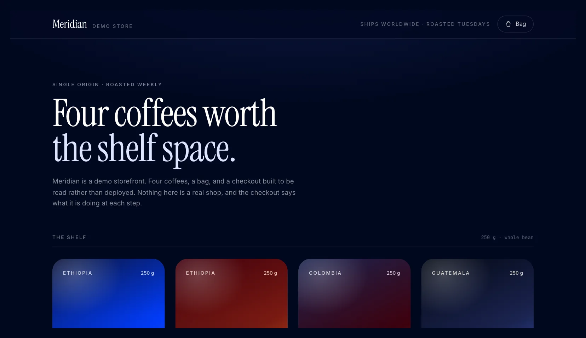
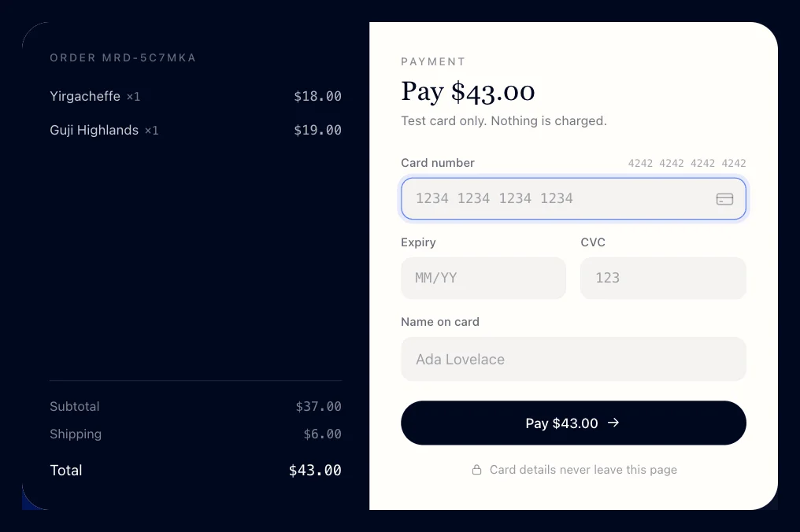
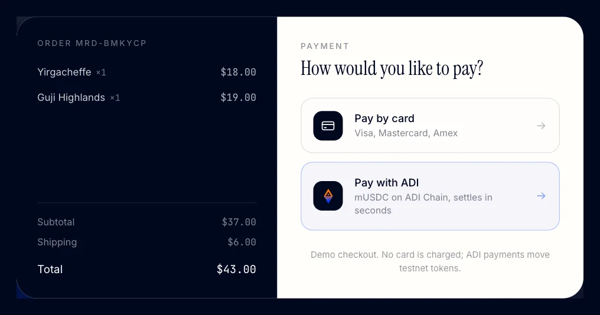
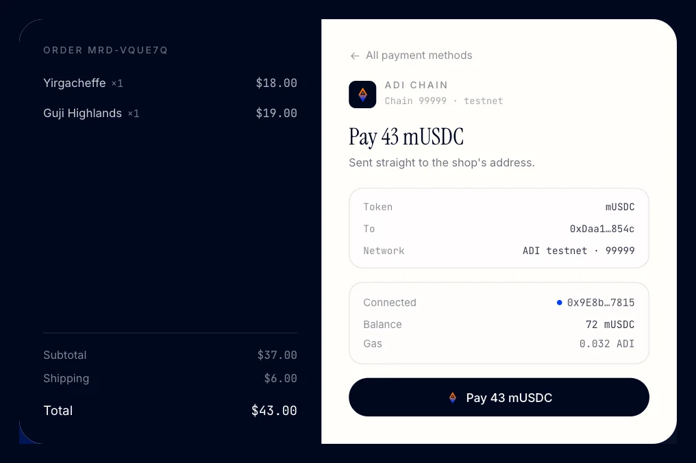
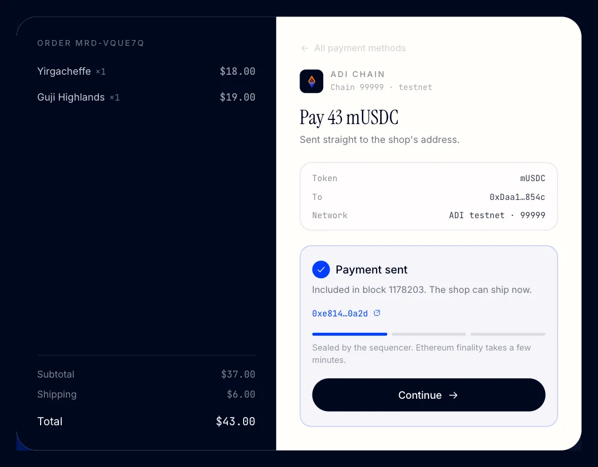
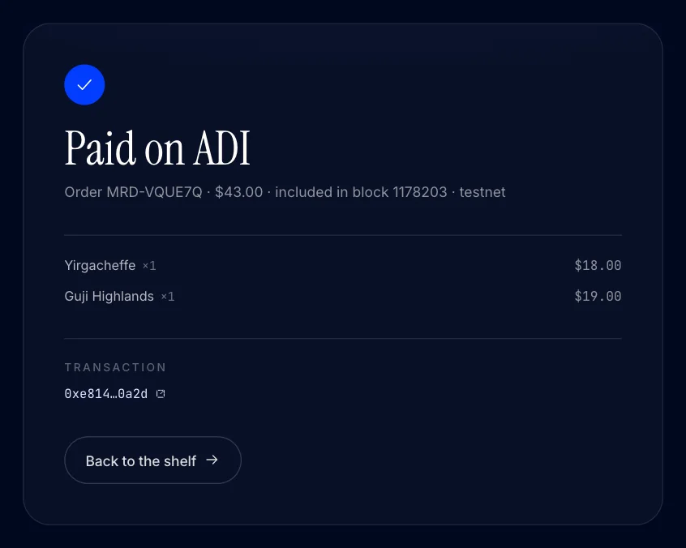
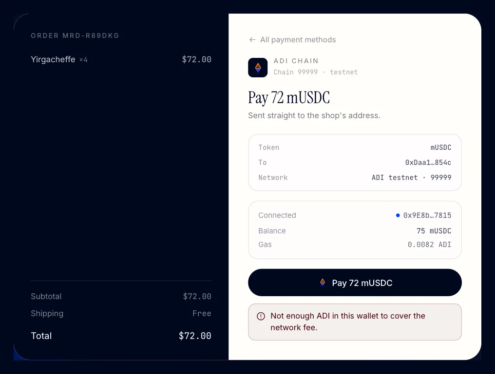

# Adding ADI payments to a shop that already takes cards

A webshop already works. Customers browse, fill a bag, pay by card, get a receipt. The question is what it takes to add a second payment method on ADI Chain without touching any of that.

This post answers it with a working demo and a two-commit diff you can read end to end. The shop is a four-SKU coffee storefront called Meridian: React, Vite, no backend, no router. Payments are mocked through a fake processor, so the only interesting thing in the repository is the payment layer.

- **Commit 1** is the shop with card payments.
- **Commit 2** adds "Pay with ADI".

Everything below is measured on the real ADI testnet, not sketched.

## Before and after

Nothing on this screen changes between the two commits:



The checkout does change. Before, it is a card form and nothing else:



After, the same order and the same totals sit behind a method picker:



Choosing ADI replaces the card form with a wallet panel. It shows the amount in mUSDC, the receiving address, the connected account, and both balances that matter, the token and gas:



One confirmation in the wallet. Then the payment is in a block:



And the receipt is the same page as before, with one row that differs:



## What actually changed

`git diff` between the two commits:

```
17 files changed, 1122 insertions(+), 56 deletions(-)
```

Five files are new, and they are the feature:

```
src/lib/adi.ts                  chain constants, wallet, payment, finality
src/components/AdiPanel.tsx     connect, confirm, included
src/components/MethodChooser.tsx
src/components/AdiMark.tsx
src/dev/wallet.ts               dev-only injected wallet, for testing
```

The rest is small and mostly mechanical. The one that shows the shape of the change is the order model, where the payment union grows a second arm:

```diff
-export type Payment = { method: "card"; reference: string };
+export type Payment =
+  | { method: "card"; reference: string }
+  | { method: "adi"; txHash: `0x${string}`; blockNumber: number };
```

The catalogue, the cart, the order totals and the bag drawer are untouched. That is the whole claim: adding a payment method is a payment-layer change, not a shop rewrite.

## The steps, in order

### 1. Add the chain and the token

Nothing in the UI works until the browser knows which chain and which token. Both are constants.

```ts
export const ADI_TESTNET: Chain = {
  id: 99999,
  name: "ADI Network AB Testnet",
  nativeCurrency: { name: "ADI", symbol: "ADI", decimals: 18 },
  rpcUrls: { default: { http: ["https://rpc.ab.testnet.adifoundation.ai"] } },
  blockExplorers: {
    default: { name: "ADI Explorer", url: "https://explorer.ab.testnet.adifoundation.ai" },
  },
};

export const SETTLEMENT_TOKEN = {
  symbol: "mUSDC",
  address: "0x9bC8244c0F531F27fe3636FFdAf2C586d11241e1",
  decimals: 6,
};
```

Two things worth knowing, both verified against the live chain rather than assumed. The testnet is chain id 99999, and the settlement token is a mock whose `mint` is open to anyone. That second fact is what makes test funds a non-problem, and I come back to it in step 5.

### 2. Connect a wallet and be on the right chain

Connect, then switch. Most wallets do not know ADI testnet, and `wallet_switchEthereumChain` fails with code `4902` when the chain is missing. That is not an error to report to the customer; it is the signal to add the chain:

```ts
try {
  await provider.request({ method: "wallet_switchEthereumChain", params: [{ chainId: hexChainId }] });
} catch (error) {
  // 4902 means the wallet does not know this chain; adding it opens the
  // confirmation the payer expects and most wallets switch automatically.
  if (errorCode(error) !== 4902) throw error;
  await provider.request({ method: "wallet_addEthereumChain", params: [{ /* … */ }] });
}
```

Then confirm you actually landed there, because some wallets return from a switch without having switched. Read `eth_chainId` back and compare.

### 3. Know the amount, in the token's units

The shop prices in integer cents. The token has six decimals. One function, no floats:

```ts
export function centsToTokenUnits(cents: number, decimals: number): bigint {
  return BigInt(cents) * 10n ** BigInt(decimals - 2);
}
```

This only holds because mUSDC is 1:1 with the dollar. If you want to price in native ADI, you need a rate, and a rate needs a feed and a quote expiry. That is a real feature with real failure modes, and pretending otherwise is how demos become lies.

### 4. Check both balances before opening a popup

The cheapest UX win in the whole flow. A wallet with no gas, or not enough token, should fail on your page, not in a wallet popup the customer has already approved:

```ts
const balance = await tokenBalance(account);
if (balance < amountRaw) throw new InsufficientTokenError(balance, amountRaw);
```

`InsufficientTokenError` carries both numbers so the panel can say "short by 28 mUSDC" instead of "transaction failed".

### 5. Make test funds one click

This is where most integrations lose people, so the demo treats it as part of the flow rather than a README footnote.

The official ADI faucet is captcha-gated and only dispenses native ADI. The settlement token has an open mint, so the checkout mints test mUSDC itself:

```ts
const hash = await wallet.writeContract({
  address: SETTLEMENT_TOKEN.address,
  abi: parseAbi(["function mint(address to, uint256 amount)"]),
  functionName: "mint",
  args: [to, amountRaw],
  account,
  chain: ADI_TESTNET,
});
```

Measured: about six seconds, gas only. On mainnet you would delete this code path entirely, because the token there is not a mock.

### 6. Send one transfer, then wait for the receipt

One contract call. The wallet popup is the only interaction:

```ts
const hash = await wallet.writeContract({
  address: SETTLEMENT_TOKEN.address,
  abi: erc20Abi,
  functionName: "transfer",
  args: [to, amountRaw],
  account,
  chain: ADI_TESTNET,
});
const receipt = await publicClient.waitForTransactionReceipt({ hash, confirmations: 1 });
```

Poll the receipt over your own RPC client, not the wallet. Wallets are not reliable JSON-RPC proxies for anything past the send.

### 7. Budget the fee cap, not the fee

One ADI-specific wrinkle that cost me an afternoon. The chain requires the sender's balance to cover the transaction's **maximum** fee, not the fee it will actually pay:

```
sender does not have enough funds (32003840000000000)
to cover transaction fees: 34200000000000000
```

If you hardcode `maxFeePerGas` to something comfortable, or leave gas at a guess like 120,000, wallets that hold just enough ADI fail validation even though the real cost was a fraction of that. Estimate gas from the actual call and read the base fee from the chain:

```ts
const gas = await rpc.estimateGas({ account, to, data });
const fees = await rpc.estimateFeesPerGas();
```

A wallet extension does this for the customer. A script, a bot or a dev wallet has to do it itself.

### 8. Say what finality means

ADI is a zkSync-OS L2, so a transaction has three stages. Inclusion is not finality, and the gap is not small.

| Stage | Meaning |
|---|---|
| `pending` | sealed by the sequencer |
| `committed` | batch committed to Ethereum |
| `executed` | batch executed, irreversible |

Measured while building this: **included in about 4.5 seconds, still `pending` after 115 seconds**. Batches commit on their own schedule, and an idle chain does not advance the frontier at all.

So the UI treats inclusion as paid, because the shop can ship on it, and shows finality as a quiet bar that fills in later. Calling a one-block transfer "settled" would be false. Blocking the receipt on Ethereum finality would confuse a customer who has already paid.

```ts
const response = await fetch(RPC_URL, {
  method: "POST",
  headers: { "content-type": "application/json" },
  body: JSON.stringify({
    jsonrpc: "2.0", id: 1,
    method: "zks_getTransactionFinality",
    params: [hash],
  }),
});
```

## Design decisions worth stealing

**The button looks like a payment method, not a wallet.** Same size, same weight, same position as the card option. The chain mark carries the only colour. A shop that suddenly grows a glowing purple "WEB3" button has told the customer something about itself.

**One receipt component, two reference rows.** A processor id or a transaction hash. The rest of the receipt is identical because the rest of the payment is identical.

**Errors are one sentence.** Wallet rejections arrive wrapped in a couple of layers of library error objects. Walk the `cause` chain and report the innermost concrete reason:

```
You rejected the request in your wallet.
Not enough ADI in this wallet to cover the network fee.
```

Not a paragraph of contract-call internals.

This one bit me during the build, so it is worth spelling out. A transaction failed because the fee cap exceeded the wallet balance. The library reported:

> The Provider does not support the requested method.

Every word of that is wrong. The wallet supported the method perfectly; it just would not pay a fee it could not afford. The real reason was three `cause` levels down, and in a `details` field rather than in any message. So the helper collects every code and every piece of prose in the chain, skips wrapper phrases, and reports the most specific thing it finds:



If you take one thing from this post for a production integration, take this: the top-level error from a wallet stack is usually not the error you want to show a customer.

There is a second half to that bug worth knowing. `viem` tries `eth_sendTransaction`, and when it rejects it may retry with `wallet_sendTransaction`. If the provider does not implement the second one, the retry's error replaces the original and the real cause is gone. My dev wallet had to implement both names for the same handler to keep the first error visible but a real extension does.

**No wallet, no dead end.** If `window.ethereum` is missing, the ADI option is disabled and says "Needs a browser wallet". The card path is unaffected, which matters because that is what most customers will use.

## What this demo does not do

No server-side order record, no webhooks, no inventory, no refunds, no rate feed. A real integration needs all of them, and each one changes the design more than the payment call itself. The point here is narrower: the ADI layer is three files, about 740 lines including comments, and none of it reaches into the catalogue, the cart or the totals.

## Try it

```sh
git clone https://github.com/idea404/adi-webshop-demo.git
cd adi-webshop-demo
bun install
bun run dev
```

Card payments work immediately. For ADI, install a browser wallet, connect from checkout, and mint test mUSDC from the shortfall callout. Everything is on testnet and nothing costs real money.
